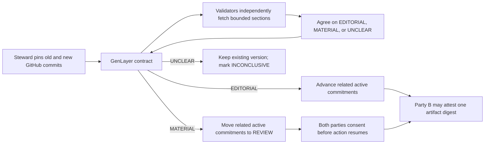

# Policy Drift Firewall

A GenLayer Native app for two-party commitments bound to versioned public policy clauses. A steward pins a raw GitHub source and exact section markers. When a new commit appears, GenLayer validators independently read the old and new sections and classify the revision as `EDITORIAL`, `MATERIAL`, or `UNCLEAR`. Contract code applies the transition:

- `EDITORIAL`: advance active commitments to the new version.
- `MATERIAL`: move only this clause's active commitments to `REVIEW`. Both parties must consent before action resumes; either can exit and anyone can expire review after seven days.
- `UNCLEAR` or unavailable source: keep the existing version and mark the proposal `INCONCLUSIVE`.

The action in this prototype is a single-use onchain artifact attestation, authorized only for party B while `ACTIVE`. `exercise` binds an artifact's lowercase SHA-256 digest and permanently changes the commitment to `EXERCISED`. It holds no collateral and transfers no GEN. It demonstrates selective version gating, not legal or financial enforcement.

## Architecture



The validator result is a bounded label and source digests. Contract code alone selects the state transition; wallet signatures establish the parties and the artifact digest.

## Current status

The contract is deployed on **Studionet** at [`0xa02c1e164D8ce654f6f1F3f33Cb6061E75564a9F`](https://explorer-studio.genlayer.com/address/0xa02c1e164D8ce654f6f1F3f33Cb6061E75564a9F). Its onchain source SHA-256 matches `contracts/policy_drift.py`: `3be5122d91ee2bb0447064d354d123c3bb8e3679f0dd8c41a4fd9f021f096b9f`. Twenty transactions finalized: **19 successful executions and one expected rejected exercise**. A live material assessment moved commitment 0 to `REVIEW` while unrelated commitment 1 remained `ACTIVE`; one consent was insufficient, two consents reactivated commitment 0, and party B exercised it exactly once. A missing section produced `UNCLEAR` / `INCONCLUSIVE` without advancing the version. The source-linked evidence is in [proof/studionet-live.json](proof/studionet-live.json), and `pnpm verify:proof` rechecks every transaction and finalized state. Four direct-mode tests, GenVM semantic validation, and the frontend build also pass.

The [hosted app](https://policy-drift-firewall-genlayer.vercel.app/) loads the Studionet deployment and historical proof without a wallet. Its transaction snapshot is labeled as recorded proof; the clauses and commitments above it are live finalized reads. The [public source repository](https://github.com/smokexbadlines-dot/policy-drift-firewall-genlayer) contains this verifier, contract, app, tutorial, and demo script. A [GitHub Pages mirror](https://smokexbadlines-dot.github.io/policy-drift-firewall-genlayer/) provides the same read-only proof.

The Vercel app displayed a connected Studionet wallet in a live browser check, and the wallet owner confirmed MetaMask showed no warning for that URL. MetaMask flagged both the original hosted domain and the GitHub Pages mirror as possible phishing or wallet-draining sites. Do not bypass a wallet warning; the read-only proof does not require a wallet.

## Local run

Requires Python 3.12+, Node.js 20+, and pnpm.

```powershell
python -m venv .venv
.\.venv\Scripts\python.exe -m pip install -r requirements-dev.txt
$env:GENVM_VERSION='v0.3.0-rc7'
.\.venv\Scripts\genvm-lint.exe check contracts\policy_drift.py
.\.venv\Scripts\python.exe -m pytest -q
cd app
pnpm install
pnpm dev
```

Open `http://127.0.0.1:5173`. The app defaults to Studionet and loads the live deployment above for read-only inspection. Bradbury is available in the network selector. Connect a funded test wallet in a browser that supplies `window.ethereum` to make writes. You can deploy another copy through the wallet or from GenLayer Studio using the [contract source](contracts/policy_drift.py), then attach its finalized address.

## Reproducible demo

The UI includes two EIP-1 changes with prefilled raw GitHub URLs and section markers. They were verified to have unique markers and source files below the contract's 48 KB cap. Both classifications were live-proven on Studionet.

1. The original `discussion-link-rule` pair changes “Github” to “GitHub” in EIP-1's `discussions-to` guidance. Its pinned versions were assessed live as `EDITORIAL`.
2. The original `execution-spec-links` pair changes the permitted test-link rule. Its pinned versions were assessed live as `MATERIAL`.
3. The full two-party flow used a new `material-review-demo` clause at the same old EIP-1 commit. Party A opened commitment 0; party B accepted. A separate commitment 1 on `discussion-link-rule` became active before the material assessment. The material verdict moved only commitment 0 to `REVIEW`. Party A consented; the state stayed `REVIEW`. Party B's attempted `exercise(0, digest)` finalized with `ERROR` and no state change. Party B then consented; commitment 0 became `ACTIVE` on version 2. Party B exercised it with the sample artifact digest, producing `EXERCISED`. Commitment 1 remained `ACTIVE` throughout.
4. Finally, the steward proposed pinned `eip-2.md` for `material-review-demo`. That file exists, but lacks the frozen EIP-1 section markers. The assessment finalized `UNCLEAR`, set the proposal to `INCONCLUSIVE`, kept the current EIP-1 version at 2, and did not alter either commitment.

The steward alone can register and propose; either party can open a commitment and the designated peer accepts. Any account can assess a frozen proposal. The app labels candidate evidence separately from recorded onchain verdicts. For `exercise`, choose a file in the app; its SHA-256 is computed locally and the file itself is not uploaded. [examples/demo-artifact.txt](examples/demo-artifact.txt) is a disposable sample.

## Verifying live proof

To recheck the complete 20-transaction proof and latest finalized state, run:

```powershell
cd app
pnpm verify:proof
```

The script compares each recorded hash with live RPC status and execution, checks the deployed code hash against the local contract, and compares the latest finalized clause and commitment state with the recorded snapshot. It exits nonzero on a mismatch. The full RPC report, including validator votes when exposed, is saved in [proof/studionet-live.json](proof/studionet-live.json). `pnpm verify` remains available for ad hoc successful transaction checks; the proof verifier explicitly expects the recorded failed `exercise` transaction to have execution `ERROR`.

## Safety and limits

- Each source URL must be a SHA-pinned `raw.githubusercontent.com` file. Section markers must occur exactly once, and extracted sections are capped at 6,000 characters.
- A validator re-fetches both sections, recomputes hashes, and reruns the one-label prompt; it compares every leader result field exactly. The LLM never chooses a party, deadline, action count, or payout.
- The contract does not independently prove that the publisher's GitHub account is the right policy authority. The steward and parties choose that source when they form their agreement.
- The artifact hash records what party B attested to, but the contract does not verify an artifact's content or authorize an external system by itself. A consuming app must check finalized `EXERCISED` state and the exact digest.
- A materiality judgment is semantic and may be uncertain. Validators can disagree; in that case consensus may fail and no state advance is proven. `UNCLEAR` is the explicit no-penalty path when evidence is unavailable or ambiguous.
- The frontend stores the chosen network, attached contract address, and a short local transaction history in browser local storage. Wallet signing stays in the browser wallet.

See [DESIGN.md](DESIGN.md) for the mechanism, [TUTORIAL.md](TUTORIAL.md) for a reproduction walkthrough, [DEMO_SCRIPT.md](DEMO_SCRIPT.md) for a short presentation, and [PORTAL_DRAFT.md](PORTAL_DRAFT.md) for draft submission fields.

Existing public GenLayer projects already cover semantic policy diffs and document drift. Policy Drift Firewall's distinct mechanism is clause-scoped reconsent for existing two-party commitments after a third-party policy change; the two-party transition is now demonstrated live. See the overlap audit and submission claims in [PORTAL_DRAFT.md](PORTAL_DRAFT.md).
