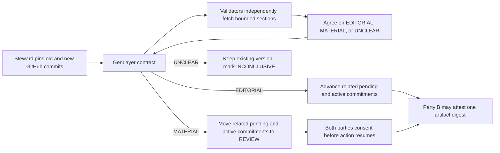

# Policy Drift Firewall

A GenLayer Native app for two-party commitments bound to versioned public policy clauses. A steward pins a raw GitHub source and exact section markers. When a new commit appears, GenLayer validators independently read the old and new sections and classify the revision as `EDITORIAL`, `MATERIAL`, or `UNCLEAR`. Contract code applies the transition:

- `EDITORIAL`: advance this clause's pending and active commitments to the new version. Pending offers still require peer acceptance.
- `MATERIAL`: move this clause's pending and active commitments to `REVIEW`. Both parties must consent before action resumes; either can exit and anyone can expire review after seven days.
- `UNCLEAR` or unavailable source: keep the existing version and mark the proposal `INCONCLUSIVE`.

Peer acceptance also checks that a pending commitment's bound URL **and** version
match the current clause. An obsolete offer cannot become active after a
revision. The regression tests cover open, revise, then accept for both
editorial and material changes.

The action in this prototype is a single-use onchain artifact attestation, authorized only for party B while `ACTIVE`. `exercise` binds an artifact's lowercase SHA-256 digest and permanently changes the commitment to `EXERCISED`. It holds no collateral and transfers no GEN. It demonstrates selective version gating, not legal or financial enforcement.

## Architecture



The validator result is a bounded label and source digests. Contract code alone selects the state transition; wallet signatures establish the parties and the artifact digest.

## Current status

The corrected contract is deployed on **Studionet** at [`0x827B9F7aE69D78CA083d6B5195AA5323AB03dAf5`](https://explorer-studio.genlayer.com/address/0x827B9F7aE69D78CA083d6B5195AA5323AB03dAf5). Its onchain source SHA-256 matches the pinned [source commit](https://github.com/smokexbadlines-dot/policy-drift-firewall-genlayer/commit/8781978ada97d9e20726f1d52af96e63ae0c9e43): `00bde2fa27b6dba0ca667d6eb7f77308c7a70b767586e5e4b19abf78fd3a1d4f`. Thirteen transactions finalized: **12 successful executions and one expected rejected acceptance**. A pending offer followed an editorial revision to version 2 and was accepted there. A second pending offer entered `REVIEW` after a material revision; an acceptance attempt finalized with `ERROR` and no state change. One consent left it in review; two consents activated it on version 2. The source-linked evidence is in [proof/studionet-live.json](proof/studionet-live.json), and `pnpm verify:proof` rechecks every transaction and latest finalized state. Six direct-mode tests, GenVM semantic validation, and the frontend build also pass.

The [hosted app](https://policy-drift-firewall-genlayer.vercel.app/) loads the Studionet deployment and recorded proof without a wallet. Its transaction snapshot is labeled as recorded proof; the clauses and commitments above it are live finalized reads. The [public source repository](https://github.com/smokexbadlines-dot/policy-drift-firewall-genlayer) contains this verifier, contract, app, tutorial, and demo script. The [GitHub Pages mirror](https://smokexbadlines-dot.github.io/policy-drift-firewall-genlayer/) provides the same read-only proof. The original deployment and its 20 historical transactions are archived under [proof/legacy](proof/legacy); those receipts do not prove the corrected source.

The Vercel app displayed a connected Studionet wallet in a live browser check, and the wallet owner confirmed MetaMask showed no warning for that URL. MetaMask flagged both the original hosted domain and the GitHub Pages mirror as possible phishing or wallet-draining sites. Do not bypass a wallet warning; the read-only proof does not require a wallet.

## Local run

Requires Python 3.12+, Node.js 20+, and pnpm.

```powershell
python -m venv .venv
.\.venv\Scripts\python.exe -m pip install -r requirements-dev.txt
$env:GENVM_VERSION='v0.3.0-rc7'
.\.venv\Scripts\genvm-lint.exe check contracts\policy_drift.py
.\.venv\Scripts\python.exe -m pytest -q
cd app
pnpm install
pnpm dev
```

Open `http://127.0.0.1:5173`. The app defaults to Studionet and loads the live deployment above for read-only inspection. Bradbury is available in the network selector. Connect a funded test wallet in a browser that supplies `window.ethereum` to make writes. You can deploy another copy through the wallet or from GenLayer Studio using the [contract source](contracts/policy_drift.py), then attach its finalized address.

## Reproducible demo

The UI includes two EIP-1 changes with prefilled raw GitHub URLs and section markers. They were verified to have unique markers and source files below the contract's 48 KB cap. Both classifications were live-proven on Studionet.

1. Party A registered `discussion-link-rule` at EIP-1 commit `b57b7e83…` and opened commitment 0 with party B. It remained `PENDING` on version 1. Validators assessed the spelling-only revision at `36507828…` as `EDITORIAL`. The pending commitment automatically rebound to the new URL and version 2; party B then accepted it, making it `ACTIVE` on version 2.
2. Party A registered `execution-spec-links` at commit `60e2285d…` and opened commitment 1, also `PENDING` on version 1. Validators assessed the operative link-rule revision at `5543b5ce…` as `MATERIAL`. Commitment 1 moved to `REVIEW`, still bound to the old URL and version; unrelated commitment 0 was unaffected.
3. Party A consented and commitment 1 remained `REVIEW`. Party B's attempted `accept_commitment(1)` finalized with execution `ERROR` and no state change. Party B then consented; the commitment became `ACTIVE`, rebound to the new URL and version 2. This demonstrates the exact open, revise, then accept bypass being closed.

The steward alone can register and propose; either party can open a commitment and the designated peer accepts. Any account can assess a frozen proposal. The app labels candidate evidence separately from recorded onchain verdicts. For `exercise`, choose a file in the app; its SHA-256 is computed locally and the file itself is not uploaded. [examples/demo-artifact.txt](examples/demo-artifact.txt) is a disposable sample.

## Verifying live proof

To recheck the complete 13-transaction proof and latest finalized state, run:

```powershell
cd app
pnpm verify:proof
```

The script compares each recorded hash with live RPC status and execution, checks the deployed code hash against the local contract, and compares the latest finalized clause and commitment state with the recorded snapshot. It exits nonzero on a mismatch. The full RPC report, including validator votes when exposed, is saved in [proof/studionet-live.json](proof/studionet-live.json). The proof verifier explicitly expects the rejected `accept_commitment(1)` transaction to have execution `ERROR`.

## Safety and limits

- Each source URL must be a SHA-pinned `raw.githubusercontent.com` file. Section markers must occur exactly once, and extracted sections are capped at 6,000 characters.
- A validator re-fetches both sections, recomputes hashes, and reruns the one-label prompt; it compares every leader result field exactly. The LLM never chooses a party, deadline, action count, or payout.
- The contract does not independently prove that the publisher's GitHub account is the right policy authority. The steward and parties choose that source when they form their agreement.
- The artifact hash records what party B attested to, but the contract does not verify an artifact's content or authorize an external system by itself. A consuming app must check finalized `EXERCISED` state and the exact digest.
- A materiality judgment is semantic and may be uncertain. Validators can disagree; in that case consensus may fail and no state advance is proven. `UNCLEAR` is the explicit no-penalty path when evidence is unavailable or ambiguous.
- The frontend stores the chosen network, attached contract address, and a short local transaction history in browser local storage. Wallet signing stays in the browser wallet.

See [DESIGN.md](DESIGN.md) for the mechanism, [TUTORIAL.md](TUTORIAL.md) for a reproduction walkthrough, [DEMO_SCRIPT.md](DEMO_SCRIPT.md) for a short presentation, and [PORTAL_DRAFT.md](PORTAL_DRAFT.md) for draft submission fields.

Existing public GenLayer projects already cover semantic policy diffs and document drift. Policy Drift Firewall's distinct mechanism is clause-scoped reconsent for existing two-party commitments after a third-party policy change; the two-party transition is now demonstrated live. See the overlap audit and submission claims in [PORTAL_DRAFT.md](PORTAL_DRAFT.md).
